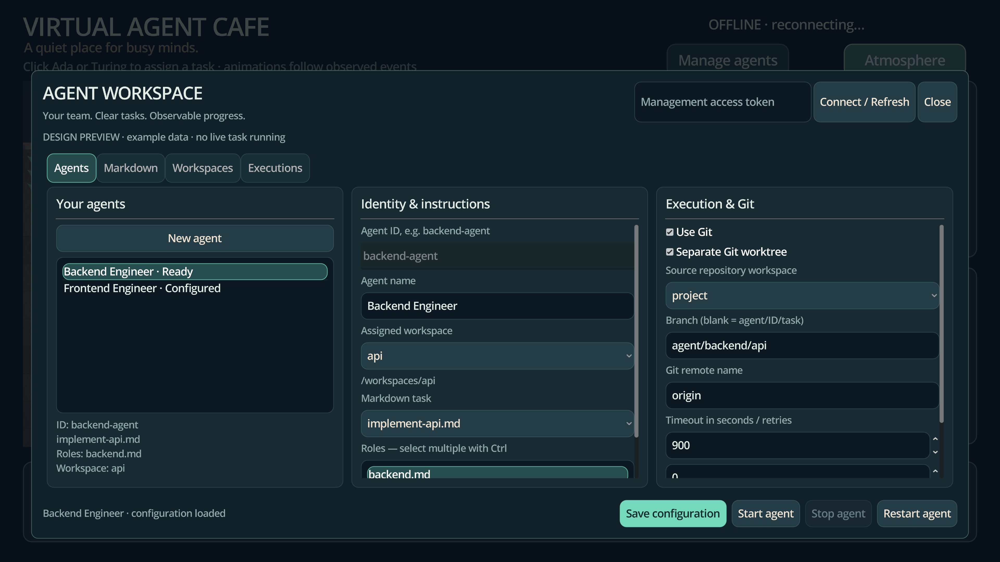

# GUI design and regression tests

The café keeps its fixed 3840×2160 viewport and scales into smaller windows.
Management uses one modal surface with a dimmed backdrop, mint primary actions,
consistent field labels, rounded cards and separately scrollable form sections.
The agent action bar stays visible when the form scrolls. Popup menus are embedded
in the game window and use matching 4K typography and bounded menu heights.



This image is an actual Godot Compatibility render using **example data**. It is
not evidence of a model task running. The renderer also generates Markdown, Git,
execution-monitoring, dropdown and original task-dialog previews.

## Bugs addressed

- User clicks during an HTTP poll used to return without sending an action.
  A bounded FIFO now retains foreground actions and prevents duplicate submissions.
- Polling rebuilt ItemList/OptionButton widgets, losing selection and interrupting
  open menus. Stable entries update in place; open menus defer automatic polling.
- Save responses could replace text typed while the request was pending. Form
  revisions preserve those newer edits and keep their unsaved indicator.
- New agent creation now selects the saved agent automatically. Start/stop/review
  actions reflect server capabilities and current lifecycle; disabled actions have
  explanations rather than apparently doing nothing.
- Background polls no longer erase validation errors. Local validation explains
  missing IDs, names, workspaces and Markdown headings before sending a request.
- Fixed large content minima pushed controls out of view. Independently scrolling
  sections, bounded labels and a fixed action bar keep controls reachable.
- ItemList did not display newline-separated metadata as intended. Agent/execution
  rows are compact; the selected agent has a separate detail summary.
- Dropdowns rendered at half the surrounding font size. Matching content scale,
  theme and menu dimensions keep both text and entries readable.
- Avatar selection used the current cursor sample instead of the received click
  coordinates. Its hit test now transforms the event position into character space.
- Original task actions now share pending/offline disabling. Both modal interfaces
  protect background controls, and the original task dialog uses the new theme.

## Actual input tests

`game/tests/test_gui_input.gd` constructs the production scene and injects
`InputEventMouseMotion`, mouse press/release and keyboard events through Godot's
input dispatch. It uses `Viewport.push_input` for pointer hit testing and
`Input.parse_input_event` for keyboard/input-map behavior. It never emits button
signals or invokes configuration/save/start/stop handlers to perform an action.
Scroll utilities reveal controls through the scroll container; subsequent pointer
hits must land inside the viewport and produce the expected backend result.

The managed scenario covers opening/closing/Escape, modal interception, all four
navigation tabs, invalid input, polling error retention, delayed-request clicks,
Markdown/role editing, dropdown keyboard selection, agent creation, duplicate
click prevention, selection retention, unsaved edits, edits during save, real CLI
fixture execution through Start, live log selection, task review, Stop, Git init,
branch creation, staging, commit, diff and disabled remote operations.

`game/tests/test_cafe_input.gd` tests the original café with real avatar pointer
hits, prompt typing, Run with Codex, public peer-message delivery, actual process
cancellation and Close. The earlier direct-method integration scenarios remain
as separate coverage of backend/event contracts.

Pytest launches an independent Uvicorn fixture for each scenario, uses temporary
workspaces/repositories and runs the actual Godot executable. The management
fixture delays requests by 500 ms to reproduce races deterministically. Its CLI
fixture is a process, not an external model call. Ordinary checks use no model quota
or external Git hosting and always stop their fixture servers/processes.

## Run locally

```bash
scripts/check.sh
```

This includes all Python tests and the input-driven GUI scenarios, plus existing
Godot state/import/headless/WebSocket checks.

To exercise rendered GUI controls in an X11 virtual display (install Xvfb and
libxkbcommon-x11 using your local environment setup):

```bash
source scripts/environment.sh
xvfb-run -a env VAC_GUI_RENDERED=1 VAC_GUI_RESOLUTION=1920x1080 \
  python3 -m pytest backend/tests/test_game_management.py -q -k gui_input
```

The rendered GUI test keeps the 4K viewport. It hides the café world in its test
fixture to focus on the management controls and reduce scene shader load on software
renderers; separate design renders include the complete café. Input remains routed
through the real Godot controls. CI runs this rendered case alongside normal tests.

Generate all design previews with the real Compatibility renderer:

```bash
xvfb-run -a env VAC_PREVIEW_DIR=/tmp/cafe-previews \
  godot --path game --audio-driver Dummy --rendering-method gl_compatibility \
  --script res://tests/render_management.gd
```

CI uploads PNG artifacts and rejects any script/shader error in renderer logs.
Linux/Mesa software rendering is automated; Windows-specific DPI, native device
input and GPU performance still need a manual check on the target machine.
