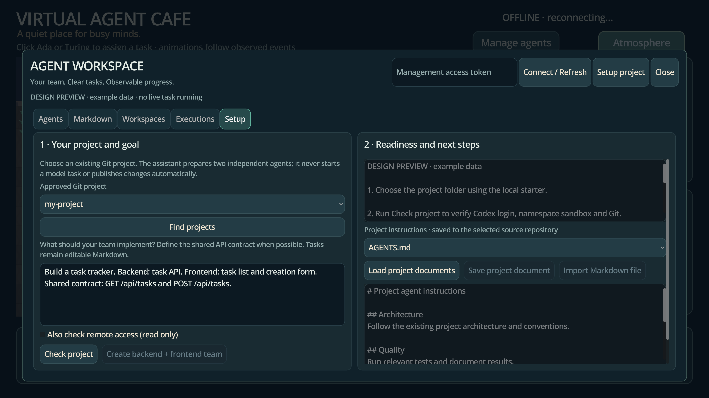

# Einrichtungsassistent für eigene Projekte

Der lokale Starter wählt einen bestehenden Git-Projektordner aus, startet das
Compose-Backend und öffnet Godot direkt im Assistenten. Dort werden Codex-Anmeldung,
Namespace-Sandbox und Git geprüft. Aus deiner Zielbeschreibung entstehen zwei
Agenten mit Markdown-Aufgaben/Rollen, eigenen Git-Worktrees und eigenen Branches.
Die bestehende Architektur und Verwaltung bleiben erhalten.



## Start auf dem Linux-/WSL-Docker-Host

Voraussetzungen: Python 3.10+, Docker Compose mit `up --wait`, Godot 4.4.1 und ein
bestehendes lokales Hauptrepository mit mindestens einem Commit. Führe den Starter
im VirtualAgentCafe-Checkout auf dem Host aus, nicht im Backend-Container:

```bash
python3 scripts/setup-project.py
```

Unter WSL öffnet sich über Windows PowerShell die native Windows-Ordnerauswahl.
Unter Linux verwendet der Starter Python-Tk, sofern eine grafische Sitzung verfügbar
ist. Ohne grafischen Dialog fragt er den Projektpfad im Terminal ab. Du kannst ihn
auch direkt angeben:

```bash
python3 scripts/setup-project.py --project /home/du/projekte/meine-app
```

Für die bisher verwendete lokale Entwicklungsumgebung, die den Privileged-Override
benötigt:

```bash
python3 scripts/setup-project.py --privileged
```

Der Starter startet das Backend im Codex-Modus und wartet auf den Healthcheck.
Fehlt die Codex-Anmeldung, öffnet er `codex login` im Container und setzt danach fort.
Mit `--login` kannst du den Anmeldevorgang ausdrücklich erneut öffnen. Die Anmeldung
bleibt im vorhandenen `codex_home`-Volume. Beide Agenten verwenden diesen Zugang;
getrennte Accounts pro Agent sind noch nicht vorgesehen.

Godot wird über `godot`/`godot4` im PATH erkannt oder explizit gewählt:

```bash
python3 scripts/setup-project.py --privileged \
  --godot '/mnt/c/Tools/Godot/Godot_v4.4.1-stable_win64.exe'
```

Bei Windows-Godot aus WSL übersetzt der Starter den Spielpfad mit `wslpath` und
übergibt Verbindungseinstellungen über `WSLENV`. Er startet direkt das Spiel;
F5 ist dabei nicht nötig. Der Starter speichert die Verbindung zusätzlich lokal in
`.runtime/setup/godot-connection.json` mit Dateirechten `0600`. Diese Datei enthält
den Managementtoken, ist von Git und Docker-Builds ausgeschlossen und darf nicht
weitergegeben werden.

Auch mit `--no-godot` wird diese Verbindung eingerichtet. Danach kannst du Godot
manuell öffnen und F5 drücken: **Manage agents** verbindet sich ohne Token-Eingabe.
Das gilt auch nach einem Godot-Neustart. Bei erneuter Einrichtung aktualisiert der
Starter die Datei; **Connect / Refresh** lädt sie erneut. **Connection settings**
blendet bei Bedarf die manuelle Eingabe ein. Ein explizites `VAC_MANAGEMENT_TOKEN`
im Godot-Prozess hat Vorrang. Exportierte Clients können den Dateipfad mit
`VAC_CONNECTION_FILE` angeben. Gespeicherte Tokens gelten nur für die zugehörige
Backend-Adresse.

## Im Assistenten

1. **Setup project** öffnet die Seite. Beim Start über den Starter ist das gewählte
   Projekt bereits ausgewählt. Angezeigt werden nur freigegebene Hauptrepositories.
2. Beschreibe das Ziel, die Aufteilung und möglichst den gemeinsamen API-Vertrag.
   Alternativ lade deine vorhandene PLANNING.md über **Load project documents**;
   bei leerer Zielbeschreibung wird ihr nächster offener Meilenstein verwendet.
3. **Check project** prüft Sandbox, gespeicherte Codex-Anmeldung, Codex-Modus und
   initialen Commit. Fehler erscheinen mit Handlungshinweisen. Die Prüfung führt
   keinen Modellauftrag aus und bestätigt keine serverseitige Modellverfügbarkeit.
   Der Prüfstatus bleibt über dem scrollbaren Bericht sichtbar. Ein Klick zeigt
   sofort „Checking…“; Fehler inklusive Verbindungs- und Zeitüberschreitungen stehen
   direkt im Bericht. Die Gesamtprüfung ist auf 30 Sekunden begrenzt. „FIX“ muss
   behoben werden, bevor das Team erstellt werden kann. Nach erfolgreicher Prüfung
   erklärt der Status auch, ob noch ein Ziel oder eine geladene PLANNING.md fehlt.
4. **Create backend + frontend team** erstellt beide Worktrees und Konfigurationen.
   Agenten heißen `PROJEKT-backend` und `PROJEKT-frontend`; ihre Branches liegen
   unter `agent/AGENT/implementation`. Aufgaben und Rollen sind weiterhin Markdown.
5. Im Setup über **Load project documents** gemeinsame Projektdateien laden.
   `AGENTS.md` und `PLANNING.md` auswählen, bearbeiten oder mit **Import Markdown file**
   eine lokale Datei über den nativen Windows-Dateidialog auswählen. Erst
   **Save project document** schreibt ins Projekt. Fehlende Dateien erhalten
   Vorlagen; vorhandene `agents.md`/`planning.md` werden ebenfalls erkannt und
   unter ihrem bisherigen Dateinamen gespeichert. Danach unter **Markdown** die Aufgaben prüfen/anpassen. Unter **Agents** jeden Agenten
   auswählen und **Start agent** klicken. Die Einrichtung allein startet keine
   kostenpflichtigen Modellaufgaben.
6. Ergebnisse, Tests und Diffs prüfen. Bei aktiviertem Publish-Schalter pusht der
   Controller erfolgreiche Läufe auf den jeweiligen Agenten-Branch. Der
   Integrationsagent kann anschließend beide Worker-Branches auf seinem eigenen
   Branch zusammenführen, gemeinsame Tests erstellen und nach grüner Prüfung den
   freigegebenen Stand nach `main` promoten (siehe
   [automatische Integration](automatic-integration.md)).

Uncommittete Änderungen bleiben im Quellrepository. Die Agentenworktrees beginnen
bei dessen HEAD; der Assistent zeigt diesen Unterschied an und erstellt selbst
keinen initialen Commit. Für einen neuen Ausgangsstand zuerst deine gewünschten
Änderungen selbst prüfen und committen.

## Codex-Anmeldung prüfen

Wenn Sandbox und Git PASS melden, aber Codex weiterhin FIX, den gespeicherten
Anmeldestatus direkt im Backend prüfen:

```bash
docker compose exec backend codex login status
```

Nur wenn dort keine Anmeldung vorhanden ist, `docker compose exec backend codex login`
ausführen. Der Assistent verwendet denselben Statusbefehl innerhalb des isolierten
Workspaces. `--ignore-user-config` ist eine Option von `codex exec`, nicht von
`codex login status`; sie gehört nicht in die Anmeldeprüfung. Benutzerkonfiguration
wird in dieser Sandbox ohnehin nicht eingebunden, nur die schreibgeschützte
Authentifizierungsdatei. Die Prüfung bestätigt gespeicherte Anmeldedaten und ruft
kein Modell auf. Ein Regressionstest verwendet die echte gepinnte CLI mit einem
Test-Auth-File und abgeschaltetem Netzwerk, sowohl mit als auch ohne Anmeldung.

## Gemeinsame Projektdateien

`AGENTS.md` enthält die Projektkonventionen und gemeinsamen Agentenregeln.
`PLANNING.md` enthält Plan, Meilensteine und Abnahmekriterien. Die Auswahl im
Dateidialog überträgt nur den Inhalt in den Editor. Vor dem Speichern kannst du
alles prüfen. Der Backend-Server erhält keinen frei wählbaren lokalen Dateipfad.

Gespeicherte Dateien bleiben normale Projektdateien und werden nicht automatisch
committed. Beide Agenten erhalten vor jedem Lauf den aktuellen Stand aus dem
Quellprojekt als schreibgeschützten Snapshot unter
`.cafe/instructions/project/AGENTS.md` beziehungsweise `PLANNING.md` — auch wenn
die Quelldateien noch nicht committed wurden oder die Worktrees ältere Versionen
enthalten. Ausführungsaufzeichnungen enthalten die SHA-256-Hashes dieser Stände.
Ein laufender Auftrag behält seinen Snapshot; Änderungen gelten für folgende Läufe.

Die Rangfolge lautet: System-Sicherheit > validierte Konfiguration > Rollen >
Projekt-AGENTS.md > Projekt-PLANNING.md > einzelne Aufgabe. Die Dateien verleihen
keine zusätzlichen Sicherheitsrechte. Speichern ist während zugehöriger laufender
Agenten gesperrt. Zwischenzeitliche Änderungen auf der Festplatte führen zu einem
Konflikthinweis statt stillem Überschreiben; lade dann die Dateien erneut.
Pro Datei sind 64 KiB UTF-8 erlaubt (Laden, Editor, Dateiimport und Speichern).
AGENTS.md und PLANNING.md dürfen mit Fließtext, Listen oder Kommentaren beginnen;
eine führende `#`-Überschrift ist optional. Der Editor zeigt die UTF-8-Bytezahl.
Leere Inhalte und zu große Dateien werden mit getrennten Meldungen abgelehnt. Symlinks und mehrdeutige Groß-/Kleinschreibung
werden abgewiesen. Den nativen Windows-Dialog musst du auf deinem Zielhost prüfen;
der automatisierte Godot-Test bedient den eingebetteten Dateidialog über Eingaben.

## SSH und Remote-Prüfung

Ist auf dem Host `SSH_AUTH_SOCK` ein erreichbarer Socket und existiert
`~/.ssh/known_hosts`, bindet der Starter beides gezielt für den Git-Dienst ein.
Private Schlüssel werden nicht kopiert oder eingebunden. Codex-Worker erhalten den
SSH-Socket nicht. Bekannte Server müssen bereits mit überprüften Host-Schlüsseln
in `known_hosts` stehen; die Prüfung wird nie abgeschaltet.

Eine Remote-Prüfung ist optional. Aktiviere sie beim Start und anschließend über
das Kontrollkästchen im Assistenten:

```bash
python3 scripts/setup-project.py --privileged --remote-checks
```

Diese Prüfung verwendet ausschließlich `git ls-remote` gegen ein unterstütztes,
zugangsdatenfreies `origin` und prüft lesenden Zugriff. Sie erzeugt keinen
Testbranch und bestätigt keine Push-Berechtigung. Fehler weisen auf SSH-Agent,
Host-Schlüssel oder Repository-Berechtigungen hin. Die neuen Agenten erhalten
weiterhin keine Push-/Pull-/Fetch-Freigaben.

Git vertraut bei eingebundenen Host-Repositories ausschließlich dem explizit
freigegebenen Workspace-Pfad über eine pro Prozess gesetzte `safe.directory`.
Es wird weder eine globale Git-Einstellung verändert noch ein Wildcard-Vertrauen
aktiviert. Hooks und externe Git-Helfer bleiben deaktiviert.

## Dateien, Persistenz und Grenzen

- Der generierte Compose-Override liegt ignoriert unter
  `.runtime/setup/project.compose.json`. Nur der gewählte externe Projektordner
  wird zusätzlich eingebunden; kein beliebiger Hostpfad ist über die API wählbar.
- Projekt-IDs verwenden bei gültiger `origin`-Adresse eine Repository-Kennung,
  sodass dasselbe Repo über andere Docker-/WSL-Pfade wiederverwendet wird. Ohne
  Remote wird ein Pfad-Hash verwendet. Lokal wird nur Hash→Workspace-ID gespeichert,
  keine Remote-URL. Der Starter unterstützt ein ausgewähltes
  externes Quellprojekt pro Backend-Start. Starte ihn zum Wiederöffnen erneut mit
  demselben Ordner; beim Projektwechsel bleiben alte Arbeitsstände erhalten.
- Compose erstellt das Backend bei geänderter Konfiguration/Image neu. Beende
  laufende Aufgaben vor einem Projektwechsel oder einem solchen Neustart.
- Agentenworktrees liegen im persistenten `agent_workspaces`-Volume. Die Git-
  Verwaltungsdaten liegen auch im `.git` des freigegebenen Quellprojekts. Diese
  Worktrees gehören zur Containerumgebung; Ergebnisse sind dort über Verwaltung,
  Git-Diffs und bei Bedarf `docker compose cp` erreichbar.
- Ein erneuter Teamerstellungsversuch erhält vorhandene Aufgaben/Konfigurationen.
  Unterbrochene Einrichtungen werden mit der ursprünglichen Zielbeschreibung
  fortgesetzt. Bestehende fremde Dateien werden nicht überschrieben.

### Projekte aufräumen und Ergebnisse nachvollziehen

Im Setup-Tab kannst du **Delete selected project** oder **Delete all managed
projects** wählen. Beide Aktionen verlangen eine Bestätigung. Entfernt werden nur
die VirtualAgentCafe-Projektzuordnungen und sauberen verwalteten Worker-Worktrees;
das ausgewählte Quellverzeichnis, seine Git-Branches und die Ausführungshistorie
bleiben erhalten. Projekte mit laufenden Agenten oder uncommitteten Änderungen
werden nicht gelöscht. Worktrees werden erst alle entfernt, danach bereinigt Git
einmalig die gemeinsamen Verwaltungsmetadaten.

Nach einem erfolgreichen Worker-Lauf zeigt **Executions** einen kurzen Recap,
geänderte Dateien, Tests und den Branch-/Commit-Nachweis. Bei aktiviertem Push wird
`agent-changelogs/<agent-id>.md` als Recap-Commit auf genau diesen Agenten-Branch
gepusht. Worker pushen nicht nach `main`; nur der aktivierte Integrationsablauf darf
seinen geprüften Integrationscommit dorthin promoten.
- Native Windows-/macOS-Launcher ohne Linux/WSL-Host, SSH-Agent-Brücken für Windows
  ohne WSL-Socket und Git-Submodule sind kein Bestandteil dieses Assistenten.
- Docker-Start, nativer Tk-Dialog und Windows-Übergabe benötigen einen Test auf dem
  Zielhost. Hier sind Launcher-Verträge automatisiert getestet; der Entwicklungs-
  container stellt keinen Docker-Daemon für einen vollständigen Hostlauf bereit.

Mount-Plan ohne Start/Änderungen anzeigen:

```bash
python3 scripts/setup-project.py --project /pfad/zum/projekt --dry-run
```

## Sandbox-Fehler beim Start

Der Starter führt nach dem Container-Healthcheck den Namespace-Selbsttest im
gewählten Projektworkspace aus. Bei Fehlern hält er vor Codex-Anmeldung und
Godot-Start an. Er erhöht Berechtigungen nicht automatisch und startet keine Worker
ohne funktionierende Isolation. Für die bisherige lokale Umgebung den expliziten
Override verwenden:

```bash
python3 scripts/setup-project.py --privileged
```

Bleibt die Prüfung blockiert, im laufenden Backend die Diagnose ausführen:

```bash
docker compose exec backend bash -lc \
  'source scripts/environment.sh && python3 scripts/sandbox-diagnostics.py'
```

Mit `--workspace /workspaces/DEINE-PROJEKT-ID` prüfst du zusätzlich genau den
Projektmount. Die Ausgabe enthält feste Fehlerkategorien und verfügbare numerische
Namespace-Einstellungen; keine Tokens, Auth-Dateien oder rohen Tool-Ausgaben.

- `namespace_denied`: Kernel-/Container-Regeln verbieten Namespace-Erstellung oder
  Mounts. Falls Privileged bereits aktiv ist, die Docker-/WSL-Hostrichtlinien prüfen.
- `namespace_limit`: Namespace-/Systemressourcen erschöpft.
- `mount_failed` / `workspace_unavailable`: Projektmount und Verzeichnisrechte prüfen.
- `runtime_missing` / `launch_failed`: Backend neu bauen beziehungsweise die lokale
  Bubblewrap-Installation prüfen.
- `timeout`: Selbsttest hat sein Zeitlimit erreicht.

Der Assistent verwendet denselben Selbsttest wie der Workerstart. Schlägt er fehl,
stehen Codex-Anmeldung und Git als **SKIP** im Bericht. Sie wurden dann nicht
geprüft; die Meldung fordert nicht mehr fälschlich zur Codex-Neuanmeldung auf.
Ein `ready`-Ergebnis belegt die lokale Namespace-Prüfung, nicht Modellverfügbarkeit
oder Git-Remote-Berechtigungen. Ein Privileged-Container kann weiterhin durch die
Konfiguration seines Hosts eingeschränkt sein; das Skript verändert diese nicht.

## API und Tests

Alle Routen benötigen den vorhandenen Managementtoken:

- `GET /management/setup`: freigegebene Hauptrepositories auflisten.
- `POST /management/setup/check`: `{ "project": "ID", "check_remote": false }`.
- `POST /management/setup/documents/load`: Projektdateien laden.
- `PUT /management/setup/documents`: Dateiinhalt mit erwartetem SHA-256 speichern.
- `POST /management/setup/team`: `{ "project": "ID", "objective": "Ziel …" }`.

`scripts/check.sh` prüft Backend, Git-Worktrees, fehlende Voraussetzungen,
Wiederaufnahme, Konflikte, Pfad-/API-Schutz, Launcher-Mounts und Tokenbehandlung.
`game/tests/test_setup_input.gd` bedient den echten Assistenten mit Maus-/Tastatur-
Ereignissen gegen einen separaten Testserver. Nur der Codex-Anmeldestatus wird im
Fixture ersetzt; Git und Namespace-Prüfung laufen tatsächlich. Kein bezahlter
Modellaufruf und kein externer Git-Dienst ist für diese Tests nötig.

## Wo liegen die Arbeitsergebnisse?

Die beiden Worker bearbeiten getrennte Projektkopien in persistenten Git-Worktrees,
zum Beispiel `/workspaces/simulationworld-9e6a873f-backend` und
`/workspaces/simulationworld-9e6a873f-frontend`. Der ursprüngliche Projektordner wird
nicht automatisch mit diesen Änderungen zusammengeführt. Im Godot-Dialog unter
**Executions** den Lauf auswählen: **Files saved in** zeigt den genauen Pfad und
daneben steht die zugehörige Branch. **Workspaces → Git** zeigt Status und Commits.
Ein fehlgeschlagener Lauf kann Teiländerungen enthalten; scheitert bereits die
Git-Vorbereitung, wurde der Worker noch nicht ausgeführt.

Dateien aus dem Backend auf den Docker-Host kopieren (Pfade aus dem Dialog übernehmen):

```bash
docker compose cp backend:/workspaces/simulationworld-9e6a873f-backend ./backend-ergebnis
docker compose cp backend:/workspaces/simulationworld-9e6a873f-frontend ./frontend-ergebnis
```

Diese Kopien dienen zur Dateiansicht. Ihre `.git`-Datei verweist weiterhin auf
Containerpfade; Git-Status, Diffs und Commits deshalb über die Verwaltung oder im
ursprünglichen Container prüfen. Die beiden Projektstände müssen nach Review
bewusst integriert werden. Ohne entsprechende Freischaltung erfolgt kein automatischer Merge oder Push.

`runtime` speichert Aufgaben, Rollen, Konfiguration und Ausführungshistorie;
`agent_workspaces` speichert die bearbeiteten Projektdateien. Normale Container-
Neuerstellung erhält diese benannten Compose-Volumes. `docker compose down -v`
löscht sie. Verwende dieselbe Compose-Projektidentität, damit beim nächsten Start
dieselben Volumes eingebunden werden.

Bei einem Git-Fehler während der Team-Einrichtung bleiben bereits gespeicherte
Aufgaben und Agentenkonfigurationen erhalten. Nach Beheben der konkret genannten
Ursache kann die Einrichtung wiederholt werden. Bestehende Arbeitsdateien werden
nicht entfernt, gesperrte Branches nicht automatisch freigegeben.

## Ergebnisse automatisch auf GitHub hochladen

Starte den Assistenten mit freigeschalteten Remote-Operationen:

```bash
python3 scripts/setup-project.py --publish-results --privileged
```

`--privileged` ist nur nötig, wenn deine Containerumgebung es für die bereits
vorhandene Namespace-Isolation benötigt. Wähle denselben Projektordner erneut.
Der Starter verwendet weiterhin den bestehenden SSH-Agenten und `known_hosts`;
es werden keine privaten Schlüssel kopiert. Der SSH-Agent muss Schreibzugriff
auf das konfigurierte Repository besitzen.

In Godot unter **Setup**:

1. Projekt auswählen und **Check project** ausführen.
2. **Push successful results to each agent's own Git branch** aktivieren.
3. **Create backend + frontend team** anklicken. Bei einem bestehenden Team wird
   die Veröffentlichung freigeschaltet; bearbeitete Aufgaben bleiben erhalten.
4. Unter **Agents** den jeweiligen Worker auswählen und **Start agent** anklicken.

Alternativ bei bestehenden Agenten unter **Agents** die Optionen **Allow push**
und **Publish committed results after successful execution** aktivieren und
**Save configuration** drücken. Dafür muss Remote Git ebenfalls über den Starter
freigeschaltet sein. Ohne diese ausdrückliche Auswahl bleibt Veröffentlichung aus.

Der Worker erhält die Anweisung, relevante Tests auszuführen und geprüfte Dateien
über den vorhandenen Git-Helper zu committen. Nach erfolgreichem Runtime-Abschluss
prüft der Controller, ob alle Projektänderungen committet sind. Er pusht genau
`HEAD` auf `refs/heads/agent/<agent-id>/…`. Tags, andere Branches, Force-Push und
Merge werden nicht ausgeführt. Die Worker erhalten keinen SSH-Agent-Socket.

Unter **Executions** zeigt **Git: PUSHED** den erfolgreichen Push. Commit-ID,
Remote-Name und Branch werden im Ausführungsdatensatz gespeichert. **FAILED**
bedeutet, dass die Veröffentlichung scheiterte; **NOT_PUBLISHED**, dass der Lauf
vor der Veröffentlichung abgebrochen/fehlgeschlagen ist. Dateien bleiben erhalten.
Bei uncommitteten Änderungen, fehlenden Rechten oder abweichender Remote-Historie
wird kein erfolgreicher Abschluss behauptet. Optional übernimmt die [Team-Automatik](automatic-integration.md) Integration und
Requirements-Tests bis zur Main-Promotion; ohne diese Freischaltung bleiben es eigene Schritte; GitHub zeigt die Ergebnisse auf den Agenten-Branches, nicht auf `main`.

## Automatisch zusammenführen, gemeinsam testen und nach main übernehmen

Im Setup zusätzlich **Integrate + requirements tests + promote green result to main**
aktivieren. Das ergänzt den Integrations-/Testworker und ersetzt die manuelle
Aufgabenannahme. [Vollständiger Ablauf und Testplanformat](automatic-integration.md).

### Push bricht mit „No user exists for uid 1000“ ab

Wenn Host- und Container-SSH funktionieren, aber der isolierte Push fehlschlägt,
benötigt OpenSSH die öffentliche Benutzerzuordnung innerhalb seiner Sandbox.
Aktuelle Versionen binden `/etc/passwd` und `/etc/group` ausschließlich lesbar
für Git-SSH ein; private Schlüssel, Shadow-Dateien und Host-Homeverzeichnisse
bleiben ausgeschlossen. Den VirtualAgentCafe-Feature-Branch aktualisieren und den
Starter im Terminal mit geladenem SSH-Agenten erneut ausführen:

```bash
python3 scripts/setup-project.py --publish-results --privileged
```

Bestehende Worktrees bleiben erhalten. Die fehlgeschlagenen Worker können danach
über Start/Restart fortsetzen; ihre Rollen und Aufgaben sollen vorhandene Änderungen
zuerst prüfen und nur offene Arbeiten abschließen. Ein früher fehlgeschlagener Push
wird nicht allein durch den Neustart automatisch nachgeholt.

### Vorhandene Agenten-Worktrees nach falschem Projekt-Mount wieder anbinden

Wenn der Starter einen Workspace unter einer anderen ID als der vorhandene Agent
meldet, den echten Projektordner direkt an die ursprünglich gespeicherte ID
binden. So bleiben Agenten-Worktrees und Ausführungen erhalten. Beispiel:

```bash
python3 scripts/setup-project.py \\
  --project /mnt/f/Workspace/SimulationWorld \\
  --workspace-id project-1467da4f208c3c30b8b116-fd507a6f \\
  --publish-results --privileged
```

`--project` muss auf den echten Projektordner mit `.git` zeigen, nicht auf einen
Docker-Desktop-Bind-Mount unter `/mnt/wsl/docker-desktop-bind-mounts/`. Die ID
muss zur `gitdir:`-Zeile im bestehenden Worker-Worktree passen. Der Starter prüft
den Sandbox-Mount, bevor Godot startet. Danach `git rev-parse --show-toplevel` im
Worker-Worktree prüfen, bevor Agenten fortgesetzt werden.


## Nächste Runde nach deinem Test auf main

Agenten und Worktrees behalten. Den aktuellen Stand auf Remote-main selbst
testen. Eine frühere automatische Veröffentlichung ist keine Voraussetzung;
auch ein bereits bestehendes Projekt kann so gestartet werden. Dann in **Setup**:

1. Das bestehende Projekt auswählen und **Load project documents** klicken.
2. Im Feld **NEXT ITERATION** die zusätzlichen Anforderungen und Abnahmekriterien
   eingeben. Alte Tasks müssen dafür nicht manuell umgeschrieben werden.
3. **Start next iteration** klicken. Dieser Klick autorisiert die neue Runde.

Der Controller lädt den aktuellen Remote-main, übernimmt ihn ohne Reset oder
Force in beide sauberen Worker-Branches, ergänzt PLANNING.md im Quellordner und
startet beide Worker. Die bisherigen Aufgaben/Rollen bleiben erhalten; der neue
Auftrag grenzt die aktuelle Runde ausdrücklich ab. Die Dokumente werden pro Lauf
unveränderlich gesichert. Jede Runde hat eine eigene ID und gespeicherte Runs;
Ergebnisse einer alten Runde können die Integration nicht vorzeitig starten.
Nach beiden erfolgreichen Veröffentlichungen folgen automatisch Integration,
Controller-Tests und die bereits konfigurierte Veröffentlichung auf main.

Kein Start durch bloßes Tippen oder Speichern: So bleibt Zeit für deinen Test und
für das Formulieren vollständiger Anforderungen. Vor dem nächsten Klick Dokumente
neu laden. Änderungen ausschließlich auf GitHub sind erst nach Aktualisierung des
lokal eingebundenen Quellordners sichtbar. Der Controller überschreibt dessen
lokalen main nicht; er aktualisiert die Worker aus Remote-main.

Bei ungesicherten Worker-Dateien, Merge-Konflikten, fehlender SSH-/Push-Freigabe
oder veralteter Planung bleibt ein konkreter Fehler sichtbar. Bestehende Dateien
werden erhalten, auch wenn die Vorbereitung schon einen Worker aktualisiert hat.
Ein teilweise gestarteter Lauf wird als fehlgeschlagene Runde gespeichert; laufende
Worker zuerst beenden lassen und dann Dokumente laden und erneut starten. Bei
Integrationsfehlern weiter Agent chat / Retry team integration verwenden.

PLANNING.md ist auf 64 KiB UTF-8 begrenzt. Abgeschlossene umfangreiche Planungen
bei Bedarf in separate Historien-Dateien archivieren und die aktuelle Planung
kompakt halten; ein einzelnes neues Anforderungsfeld erlaubt 16.000 Zeichen.


Die Compose-Dienste verwenden `init: true`, damit verwaiste Sandbox-Prozesse
aufgeräumt werden. Bestehende Container müssen neu erstellt werden, damit diese
Einstellung wirksam wird. Bei ausgeschöpften Namespace-Grenzen trotz freiem
Plattenplatz den betroffenen Container neu starten; Isolation nicht deaktivieren.
