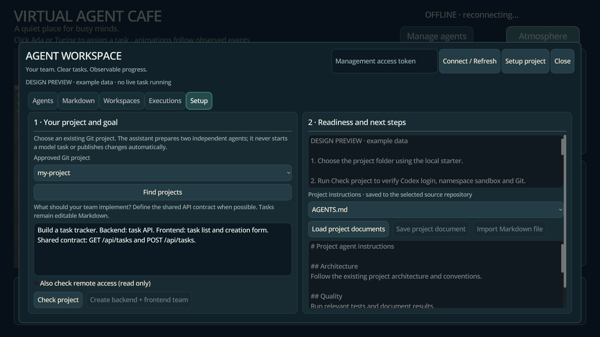

# Setup wizard for your projects

The local starter selects an existing Git project folder, starts the Compose
backend and opens Godot in the wizard. It checks Codex login, namespace isolation
and Git. Your objective becomes two agents with Markdown tasks/roles, separate
Git worktrees and branches, using the existing management architecture.



## Start on the Linux/WSL Docker host

Requirements: Python 3.10+, Docker Compose supporting `up --wait`, Godot 4.4.1
and a local main repository with at least one commit. Run from the VirtualAgentCafe
checkout on the host, not inside the backend container:

```bash
python3 scripts/setup-project.py
```

WSL opens the native Windows folder chooser through PowerShell. Linux uses Python
Tk when a graphical session is available; otherwise enter the path in the terminal.
You can also pass it explicitly:

```bash
python3 scripts/setup-project.py --project /home/you/projects/my-app
```

For local environments requiring the privileged namespace override:

```bash
python3 scripts/setup-project.py --privileged
```

The starter runs the backend in Codex mode and waits for health. It opens `codex
login` inside the container when needed, then continues. Use `--login` to reopen
login explicitly. Credentials persist in the `codex_home` volume. Agents share
this login; separate accounts per agent are not currently supported.

Godot is discovered as `godot`/`godot4` on PATH or selected explicitly:

```bash
python3 scripts/setup-project.py --privileged \
  --godot '/mnt/c/Tools/Godot/Godot_v4.4.1-stable_win64.exe'
```

For Windows Godot from WSL, the starter translates the game path with `wslpath`
and forwards connection settings through `WSLENV`. It starts the game directly,
without F5. It also saves `.runtime/setup/godot-connection.json` locally with mode
`0600`. This contains the management token, is excluded from Git/Docker builds,
and must remain private.

Connection setup also runs with `--no-godot`. You can then open Godot manually
and press F5; **Manage agents** connects without token entry, including after
Godot restarts. Rerunning setup updates the file; **Connect / Refresh** reloads it.
**Connection settings** exposes manual entry when needed. An explicit
`VAC_MANAGEMENT_TOKEN` in Godot's environment takes precedence. Exported clients
can specify `VAC_CONNECTION_FILE`. Stored tokens apply only to their saved backend address.

## In the wizard

1. Open **Setup project**. Launching through the starter preselects your folder.
   Only approved main repositories are listed.
2. Describe the objective, division of work and preferably the shared API contract.
   Alternatively use **Load project documents** to load PLANNING.md. An empty
   objective uses its next open milestone.
3. **Check project** checks sandbox, stored Codex login, Codex mode and initial
   commit. It does not run a model task or verify server-side model access. Status
   remains above the scrollable report; clicks immediately show “Checking…” and
   connection/timeout errors appear in the report. The overall timeout is 30 seconds.
   Resolve **FIX** items before creating a team. After a successful check, status
   also explains whether an objective or loaded PLANNING.md is still missing.
4. **Create backend + frontend team** creates worktrees and configurations.
   Agent IDs are `PROJECT-backend` and `PROJECT-frontend`, with branches under
   `agent/AGENT/implementation`. Tasks and roles remain Markdown.
5. Use **Load project documents** to load `AGENTS.md`/`PLANNING.md`, edit them,
   or use **Import Markdown file** to choose a local file. Only **Save project
   document** writes to the project. Missing files get templates; existing lowercase
   names are recognized and preserved. Review tasks under **Markdown**, then select
   each worker under **Agents** and click **Start agent**. Setup itself starts no
   paid model tasks.
6. Review results, tests and diffs. When publication is enabled, successful runs
   are pushed to each worker's own branch. The integration agent can combine those
   branches, create shared tests and promote the authorized result to `main` after
   controller validation. See [automatic integration](automatic-integration.md).

Uncommitted source changes remain in the source repository. Agent worktrees start
at its HEAD; the wizard explains this and does not create an initial commit.
Review and commit your desired baseline yourself before creating worktrees.

## Check Codex login

If sandbox and Git pass but Codex reports FIX, inspect stored login in the backend:

```bash
docker compose exec backend codex login status
```

If no login exists, run `docker compose exec backend codex login`. The wizard uses
the same status command inside the isolated workspace. `--ignore-user-config`
belongs to `codex exec`, not `codex login status`. User configuration is not mounted
in this sandbox; only the read-only authentication file is exposed. This confirms
stored credentials without a model call. A regression test uses the pinned CLI,
a test auth file and disabled networking, both with and without login.

## Shared project documents

`AGENTS.md` defines conventions and shared agent rules. `PLANNING.md` defines the
plan, milestones and acceptance criteria. File import loads content into the editor
for review; the backend never receives an arbitrary local file path.

Saved files remain ordinary uncommitted project files. Before each run, both agents
receive the current source documents as read-only snapshots at
`.cafe/instructions/project/AGENTS.md` and `PLANNING.md`, even if the source is
uncommitted or the worktree has older versions. Execution records store SHA-256
hashes. Active runs keep their snapshots; edits apply to later runs.

Precedence: system security > validated configuration > roles > project AGENTS.md
> project PLANNING.md > individual task. Documents cannot grant security permissions.
Saving is blocked while associated agents run. Concurrent disk changes produce a
conflict instead of silent overwrite; reload documents before retrying.

Each file is limited to 64 KiB UTF-8 across loading, editing, import and saving.
Prose, lists and comments are allowed; a leading `#` heading is optional. The editor
shows UTF-8 byte count. Empty and oversized content have distinct errors. Symlinks
and ambiguous filename case are rejected. Native Windows dialogs still need host
verification; automated Godot tests interact with the embedded chooser.

## SSH and remote checks

If host `SSH_AUTH_SOCK` points to a reachable socket and `~/.ssh/known_hosts` exists,
the starter mounts them for the Git service. Private keys are never copied/mounted;
Codex workers do not receive the SSH socket. Verified server host keys must already
be in `known_hosts`; verification is never disabled.

Remote inspection is optional. Enable it in the starter and then the wizard checkbox:

```bash
python3 scripts/setup-project.py --privileged --remote-checks
```

The check only runs `git ls-remote` against a supported, credential-free `origin`.
It verifies read access, creates no test branch and does not establish push permission.
Errors identify SSH-agent, host-key or repository-access problems. This check alone
does not grant new agents push/pull/fetch access.

For host mounts, Git trusts only the approved workspace path through per-process
`safe.directory`; it does not change global configuration or trust wildcards.
Hooks and external Git helpers remain disabled.

## Files, persistence and limits

- The generated ignored override is `.runtime/setup/project.compose.json`. Only
  the selected external source folder is mounted; API clients cannot select arbitrary host paths.
- A valid `origin` supplies repository identity so the same repository can be reused
  across Docker/WSL paths. Without a remote, a path hash is used. Only a hash-to-ID
  mapping is saved locally, not the remote URL. One external source project is mounted
  per backend start. Rerun the starter with the same folder to reopen it; switching
  projects preserves old working data.
- Compose recreates the backend when configuration/image changes. Stop active work
  before changing projects or restarting this way.
- Worktrees persist in `agent_workspaces`; Git administration also lives in the source
  project's `.git`. These worktrees belong to the container environment. Inspect results
  through management/Git diffs or use `docker compose cp`.
- Repeated team creation preserves tasks/configuration. Interrupted setup resumes
  with the original objective; unrelated existing files are not overwritten.

### Clean up projects and inspect results

In Setup, **Delete selected project** and **Delete all managed projects** require
confirmation. They remove managed project assignments and clean worker worktrees,
while retaining the source folder, branches and execution history. Active agents
and uncommitted work block deletion. Cleanup removes only the relevant stale,
unlocked worktree registrations; it does not prune unrelated entries.

After a successful worker run, **Executions** shows a recap, changed files, tests
and branch/commit evidence. With publication enabled, a recap commit containing
`agent-changelogs/<agent-id>.md` reaches that agent branch. Workers do not publish
to main; only the enabled integration workflow may promote its validated commit.

Native Windows/macOS launchers without Linux/WSL, Windows SSH bridges without a WSL
socket and Git submodules are outside the wizard's scope. Docker startup, Tk and
Windows handoff require target-host testing. Launcher contracts are automated;
a development container without a Docker daemon cannot perform a full host launch.

Preview the mount plan without writing or starting anything:

```bash
python3 scripts/setup-project.py --project /path/to/project --dry-run
```

## Sandbox startup failures

After container health, the starter probes namespace isolation in the selected
workspace. Failure stops before Codex login and Godot startup. It never raises
permissions automatically or runs workers without isolation. Explicitly use
`--privileged` if your local environment requires it.

For a blocked check, run diagnostics inside the running backend:

```bash
docker compose exec backend bash -lc \
  'source scripts/environment.sh && python3 scripts/sandbox-diagnostics.py'
```

Add `--workspace /workspaces/YOUR-PROJECT-ID` to inspect the exact mount. Output
contains fixed categories and available numeric namespace settings, not tokens,
auth files or raw tool output:

- `namespace_denied`: kernel/container rules reject namespaces or mounts. If already
  privileged, check Docker/WSL host policies.
- `namespace_limit`: namespace/system resources exhausted.
- `mount_failed` / `workspace_unavailable`: check mounts and directory permissions.
- `runtime_missing` / `launch_failed`: rebuild the image or check Bubblewrap installation.
- `timeout`: the self-test reached its deadline.

Wizard and worker startup use the same probe. When it fails, login/Git checks show
**SKIP**, not misleading login instructions. `ready` proves local isolation, not
model access or remote Git permissions. Host policies may still constrain privileged
containers; the starter does not modify them.

## API and tests

All routes require the management token:

- `GET /management/setup`: list approved main repositories.
- `POST /management/setup/check`: `{ "project": "ID", "check_remote": false }`.
- `POST /management/setup/documents/load`: load project files.
- `PUT /management/setup/documents`: save content with the expected SHA-256.
- `POST /management/setup/team`: `{ "project": "ID", "objective": "Objective …" }`.

`scripts/check.sh` covers backend, worktrees, missing prerequisites, resume, conflicts,
path/API protections, launcher mounts and token handling. `game/tests/test_setup_input.gd`
uses real mouse/keyboard events against a separate test server. Only Codex login
status is replaced; Git and namespaces are real. No paid model call or external Git
service is needed.

## Where are the working results?

Workers edit separate persistent Git worktrees, for example
`/workspaces/simulationworld-9e6a873f-backend` and
`/workspaces/simulationworld-9e6a873f-frontend`. Changes are not automatically merged
into the original source checkout. Select a run under **Executions**: **Files saved
in** shows its exact path and branch. **Workspaces → Git** shows status and commits.
Failed runs can leave partial changes; if Git preparation failed, the worker never ran.

Copy files to the Docker host, using paths from the dialog:

```bash
docker compose cp backend:/workspaces/simulationworld-9e6a873f-backend ./backend-result
docker compose cp backend:/workspaces/simulationworld-9e6a873f-frontend ./frontend-result
```

These copies are for file inspection. Their `.git` files still reference container
paths, so inspect Git status/diffs/commits in management or the original container.
Integration and publication require the corresponding explicit configuration.

`runtime` stores tasks, roles, configuration and execution history;
`agent_workspaces` stores edited files. Ordinary container recreation preserves
named volumes; `docker compose down -v` deletes them. Keep the same Compose project
identity to reuse those volumes.

Git setup failures preserve saved tasks/configuration. Fix the reported cause and
retry setup. Existing files are not deleted; occupied branches are not released automatically.

## Publish results to GitHub automatically

```bash
python3 scripts/setup-project.py --publish-results --privileged
```

Use `--privileged` only if required for isolation. Select the same project folder.
The starter uses the existing SSH agent and `known_hosts`; no private keys are copied.
The loaded identity needs write access to the configured repository.

In Godot **Setup**:

1. Select the project and run **Check project**.
2. Enable **Push successful results to each agent's own Git branch**.
3. Click **Create backend + frontend team**. Existing teams gain publication
   permission while retaining edited tasks.
4. Select each worker under **Agents** and click **Start agent**.

Alternatively, enable **Allow push** and **Publish committed results after successful
execution** in existing agent configurations and click **Save configuration**.
Remote Git must also be enabled through the starter. Publication stays off without
this explicit choice.

Workers are instructed to run relevant tests and commit checked files through the
Git helper. After successful runtime completion, the controller requires all project
changes committed and publishes the recorded HEAD to `refs/heads/agent/<agent-id>/…`.
It does not publish tags, other branches or force-push. Workers never receive the
SSH agent socket. The controller verifies the remote tip after publication.

**Executions → Git: PUSHED** records successful publication, commit, remote and branch.
**FAILED** means publication failed; **NOT_PUBLISHED** means the run failed/stopped
before publication. Files remain. Dirty trees, missing permissions or divergent
remote history cannot be reported as success. Without [team automation](automatic-integration.md),
results are on agent branches, not main.

## Merge, test together and promote to main

Also enable **Integrate + requirements tests + promote green result to main**.
This adds the integration/test worker and removes the need for manual task acceptance.
See the [workflow and test-plan format](automatic-integration.md).

### Push fails with “No user exists for uid 1000”

If host/container SSH works but isolated push fails, OpenSSH needs public user identity
mapping inside its sandbox. Current versions mount `/etc/passwd` and `/etc/group`
read-only for Git SSH; private keys, shadow files and host home directories remain
excluded. Update VirtualAgentCafe and rerun the starter from a terminal with a loaded
SSH agent. Existing worktrees remain. Resume failed workers with Start/Restart;
their tasks should inspect previous work and finish only outstanding changes.
Restart alone does not retry an earlier failed publication.

### Reconnect worktrees after mounting the wrong source

If setup reports a different workspace ID from the existing agent, bind the real
source folder to the originally saved ID to preserve worktrees/history:

```bash
python3 scripts/setup-project.py \
  --project /mnt/f/Workspace/SimulationWorld \
  --workspace-id project-1467da4f208c3c30b8b116-fd507a6f \
  --publish-results --privileged
```

`--project` must select the real folder containing `.git`, not a temporary path under
`/mnt/wsl/docker-desktop-bind-mounts/`. The ID must match the worker's `gitdir:` line.
The starter checks isolation before launching Godot. Verify `git rev-parse
--show-toplevel` in the worker worktree before resuming agents.

## Next iteration after reviewing main

Keep agents/worktrees and review current remote main yourself. A previous automatic
publication is not required; an existing project may also start this way. In Setup:

1. Select the existing project and click **Load project documents**.
2. Enter additional requirements/acceptance criteria under **NEXT ITERATION**.
   Existing tasks need not be rewritten manually.
3. Click **Start next iteration** to authorize the round.

The controller loads current remote main, merges it into clean worker branches
without reset/force, appends source PLANNING.md and starts both workers. Existing
tasks/roles remain; new instructions delimit the round. Each run freezes its documents;
each iteration has an ID and recorded runs, so old results cannot start integration
prematurely. Both successful publications trigger integration, controller tests and
the already-configured main promotion.

Typing/saving alone never starts work. Reload documents before the next click.
GitHub-only edits become visible after updating the mounted source folder. The
controller updates workers from remote main, not the local source main checkout.

Unsaved worker files, merge conflicts, missing SSH/push permission and stale planning
produce concrete errors. Existing files survive partial preparation. A partially
started round is recorded as failed; let running workers finish, reload documents
and retry. Use Agent chat / Retry team integration for integration failures.

PLANNING.md is limited to 64 KiB UTF-8. Archive lengthy completed plans in separate
history files and keep current planning concise. The new-requirements field allows
16,000 characters.

Compose services use `init: true` to reap orphaned sandbox processes. Recreate existing
containers to apply it. If namespace limits are exhausted despite free disk space,
restart the affected container rather than disabling isolation.
